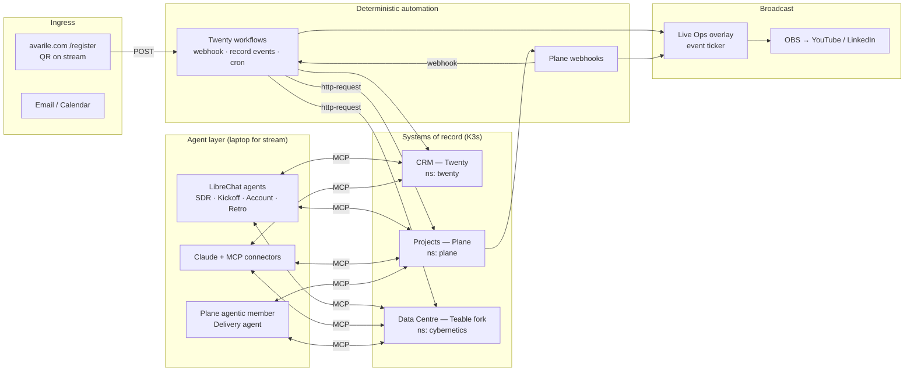

# Live Stream Demo: "Lead to Delivery, Live" — Design

**Status:** design / validation · **Date:** 2026-10-15 · **Owner:** avarile

Goal: livestream one real client-facing workflow running end to end across the Cybernetics stack (Data Centre, Projects, CRM, Agents), showing which steps are plain automation, which are AI agents, and where the human still decides.

---

## 1. Verdict: possible, with four gaps to close first

**It can be done.** Most of what the demo needs is already built and deployed. Four gaps need closing, and none of them needs a new platform.

### What already exists (checked in the repos and on the cluster, 2026-10-15)

| Capability | Where | Evidence |
|---|---|---|
| Public lead capture → CRM | `avarile.com/register` → Twenty workflow webhook (v2, upsert Person by email, UTM + persona fields) | `src/components/register-form.tsx`, `presentation-crm/web-hook.md` |
| CRM automation engine | Twenty workflows. Triggers: webhook, record events, cron, manual. Actions: `record-crud`, `if-else`, `filter`, `iterator`, `delay`, `form`, `http-request`, `code`, `logic-function`, `mail-sender`, `create-calendar-event`, **`ai-agent`** | `cybernetics-crm/packages/twenty-server/.../workflow-actions/` |
| CRM ↔ Data Centre link | "Database record targets": attach Data Centre records to CRM records, with snapshot refresh | crm commits `b98f0029`, `7e2638b0` |
| Projects ↔ Data Centre link | Work-item "Database" browser (read-only proxy) | `cybernetics-projects/apps/api/plane/app/views/cybernetics_data/` |
| Projects agentic members | Agents defined in the workspace that take assignments, follow a workflow, stop at approval steps and report through comments | projects commit `29db3793`, MCP tools `get_agent_task_brief`, `list_agent_work_items` |
| Projects outbound webhooks | Plane webhook task (work item / project / cycle events) | `apps/api/plane/bgtasks/webhook_task.py` |
| MCP on every system | `cybernetics-data` (records, graph, schema), `cybernetics-project-management` (85 tools), `Cybernetics` CRM MCP | all three are connected to this Claude session |
| Agent runtime | LibreChat fork: agents, MCP servers, tool approval modes, scheduled runs, event-bound agents, skills, OTel/Langfuse fan-out | `cybernetics-agents`, running on `localhost:3080` |
| Capacity | K3s node `k8s-micro-server`: 12 cores at **3% CPU**, 15 GiB RAM at **58%** (about 5.7 GiB free), 294 GB disk free. Shared Mongo, Meilisearch, pgvector, Redis, MinIO and Qdrant already run in `infra`. An empty `librechat` namespace exists | `kubectl top` on 2026-10-15 |

### Gaps to close

| # | Gap | Why it matters on stream | Fix (lean option first) |
|---|---|---|---|
| G1 | **Data Centre has no outbound webhooks or automations** | It can't *start* a flow. It can only be read and written | Keep it as the system of record and memory. Agents and Twenty `http-request` steps write to it. It never needs to push events in this demo |
| G2 | **No native CRM → Projects or Projects → CRM link** | "Deal won → project kicks off" and "work done → client updated" are the money shots | Twenty `http-request` action → Plane REST API (deal won → project). Plane webhook → a second Twenty **webhook-triggered workflow** (work item done → CRM note/task). No extra service |
| G3 | **Agents run only on the laptop** | Fine for a stream, because viewers watch the screen and don't use the agent | Run LibreChat locally during the stream. Deploy to K3s only if viewers must chat with the agent themselves (§9) |
| G4 | **The registration webhook has no auth and does last-touch overwrites** | The QR code is shown to the public: spam, fake leads, and anyone can overwrite a real record | Before air: add API-key auth through a small proxy or a Twenty logic function, a Turnstile check on the form, rate limits, a honeypot field, and first-touch UTM logic in the workflow |

Also a hard requirement: a **separate demo tenant** (§7). The real Data Centre holds credentials and finance tables, so they must be impossible to reach from anything shown on screen.

---

## 2. The story: one client journey, six acts

The audience follows one fictional prospect, **"Northwind Studio"** (a 6-person design agency), from first contact to a delivered first milestone. At one point the audience becomes the lead themselves.

```
 Act 1          Act 2              Act 3            Act 4             Act 5              Act 6
 CAPTURE  →  QUALIFY & REPLY  →  WIN & KICKOFF  →  DELIVER  →  REPORT TO CLIENT  →  LEARN
 website      agent + CRM +       CRM → Projects    Projects agent   agent across all   retro → Data
 → CRM        Data Centre KB      + Data Centre     member + human   three systems      Centre knowledge
```

| Act | Client-facing step | What's automated (deterministic) | What the agent does (judgement) | Human-in-the-loop moment |
|---|---|---|---|---|
| **1 Capture** | Lead fills in `/register` | Webhook → upsert Person → workflow: create Company from domain, tag `utm_source=livestream`, create a "Respond within 1h" CRM task | Twenty `ai-agent` step classifies fit (persona, team size, use case) into a 1–5 score plus a one-line reason | none (fully automatic, it happens live in front of viewers) |
| **2 Qualify & reply** | Personal reply + meeting offer | Workflow `if-else`: score ≥ 3 → hand off to the agent, otherwise → nurture sequence | **SDR agent** (LibreChat, MCP to CRM + Data Centre) reads the lead, pulls service catalogue, pricing and case studies from the Data Centre `knowledges` table, drafts the email, proposes 3 slots from the calendar, logs a CRM note | Host **approves the email** in LibreChat's tool-approval prompt before it sends |
| **3 Win & kickoff** | Proposal accepted | Opportunity stage → `WON` triggers a workflow: `http-request` to Plane creates the project from a template (modules: Onboarding, Discovery, Build), writes the project row in Data Centre `projects`, links the record back to the CRM opportunity | **Kickoff agent** turns the proposal into work items with estimates and dependencies and assigns the right ones to the agentic member | Host reviews the plan and drags one item to fix it, to show it's a draft and not a black box |
| **4 Deliver** | First deliverable (onboarding pack / discovery questionnaire) | Plane assigns to the agentic member, posts state changes as comments | **Delivery agent** (Plane agentic member) runs `get_agent_task_brief`, follows its workflow, produces the deliverable, comments progress, **stops at the approval step** | Host approves. The Plane webhook fires and the CRM timeline gets "Milestone delivered" |
| **5 Report** | Weekly client status update | Cron (or button) trigger | **Account agent** joins Plane progress, CRM touchpoints and Data Centre budget/hours into a client-ready status email and a chart | Host edits one sentence, then sends |
| **6 Learn** | Nothing client-visible (the payoff for *you*) | Project close → retro template created | **Retro agent** writes a lessons-learned entry to Data Centre `knowledges`, linked to the project and the client | Callback: rerun Act 2 for a new lead. The SDR agent now cites the lesson. **This shows the closed loop from `background.md`** |

**Optional Act 2b, "AI agnostic":** run the same Act 2 prompt in Claude (claude.ai with these MCP connectors) and then in LibreChat on a different model. Same data, same tools, different provider. This backs up principle #2 in `background.md` better than any slide could.

---

## 3. Architecture



### Design rules

1. **Automation moves data, agents make judgement calls.** Every trigger, hand-off and state change runs as a deterministic Twenty workflow or Plane webhook, so it's repeatable and debuggable live. Agents are used only where a human would otherwise think: scoring, writing, planning, summarising.
2. **Data Centre is the memory.** Every agent reads context from it and writes outcomes back to it. That gives the "every decision is recorded" story.
3. **Every outbound client action needs human approval** (email send, report send, plan publish). Uses LibreChat tool-approval modes and the Plane agent workflow's approval steps.
4. **No new service unless forced.** Twenty workflows double as the event bus (G2). If that gets messy, the fallback is one small `cybernetics-bridge` Node service in K3s (about 100 MB RAM) that receives Plane webhooks and fans out.

### Integration matrix

| From → To | Trigger | Mechanism | Status |
|---|---|---|---|
| Website → CRM | form submit | Twenty webhook workflow | ✅ live (needs G4 hardening) |
| CRM → CRM (score, task, tag) | Person created | Twenty workflow + `ai-agent` action | 🔨 build |
| CRM → Projects | Opportunity = WON | Twenty `http-request` → Plane API (`POST /projects`, `/work-items`) | 🔨 build |
| CRM → Data Centre | Opportunity = WON | Twenty `http-request` → Teable record API, then attach as record target | 🔨 build (attach UI ✅ exists) |
| Projects → CRM | work item state → Done / approval | Plane webhook → Twenty webhook workflow → note/task on opportunity | 🔨 build |
| Projects ↔ Data Centre | browse/link | existing Database browser | ✅ exists |
| Agents ↔ all | tool calls | MCP servers (3) | ✅ exists; register all three in LibreChat `mcpServers` with demo-scoped tokens |
| All → overlay | events | Twenty `http-request` + Plane webhook → overlay feed (§5.3) | 🔨 build |

---

## 4. Agent roster

All agents run in LibreChat with a pinned model, a system prompt stored as a skill in `cybernetics-agents/skill/`, and **tokens scoped to the demo tenant only**.

| Agent | Tools (MCP) | Inputs | Output | Guardrail |
|---|---|---|---|---|
| **Lead Scorer** (Twenty `ai-agent` step) | none (prompt only) | Person fields | `fitScore` 1–5, `fitReason` | JSON schema output; on failure the workflow defaults to score 3 |
| **SDR** | CRM read/write notes, Data Centre query `knowledges`, calendar | Person + Company | email draft, 3 slots, CRM note | send needs approval; cites the KB record IDs it used |
| **Kickoff Planner** | Plane create project/modules/work items/relations, Data Centre `projects` | proposal text + template | project plan | creates in `Draft`/`Backlog` only; host publishes |
| **Delivery** (Plane agentic member) | Plane comments/state, Data Centre read | assigned work item brief | deliverable + progress comments | workflow has an explicit "await human approval" step |
| **Account Manager** | read across all three | client ID | status email + chart | send needs approval |
| **Retro** | Data Centre write `knowledges`, Plane read activities | closed project | lessons-learned entry | appends only; never edits existing knowledge |

---

## 5. Broadcast production

### 5.1 Platform and format

- **Primary: LinkedIn Live** (B2B buyers who'd hire you), **simulcast to YouTube** (search + VOD). Use OBS with the multi-RTMP plugin, or Restream if one more upload is too much for your connection.
- **Length:** 45 min (35 demo + 10 Q&A). **Cadence:** monthly series, one workflow per episode (§10).
- **Upload bandwidth:** 1080p30 at about 6 Mbps per destination. Simulcasting from OBS directly needs about 12+ Mbps of steady upload. Test with a 30-minute private stream.

### 5.2 OBS scenes

| Scene | Layout | Used in |
|---|---|---|
| `00 Intro` | Full camera + title card + QR code | cold open |
| `01 Mission Control` | 2×2 grid: CRM · Projects · Data Centre · Agent chat, camera bubble bottom-right, **Live Ops ticker** across the bottom | Acts 1, 3 |
| `02 Focus` | One app full screen + camera bubble + ticker | Acts 2, 4, 5 |
| `03 Architecture` | Animated version of the §3 diagram, highlighting the active path | between acts |
| `04 Split Compare` | Claude vs LibreChat side by side | Act 2b |
| `05 BRB / Fallback` | Pre-recorded clip of the current act | failure recovery (§8) |
| `06 Q&A` | Camera + chat overlay + "Ask the agent" panel | close |

Use one **clean Chrome profile** with no extensions, bookmarks or autofill, logged in only to demo accounts, at 125% zoom and fixed window sizes, so a scene switch never shows something private.

### 5.3 Live Ops overlay (the thing that makes it feel "live")

A small page used as an OBS Browser Source. It shows a scrolling ticker of system events with an icon per system:

```
● CRM   New lead: J. D***  (Founder, 2–10)  score 4 ★   · 19:04:12
● AGENT SDR drafted reply — awaiting approval            · 19:04:31
● PM    Project "Northwind Onboarding" created (12 items) · 19:11:05
● DATA  Lesson saved: "Ask about brand assets in week 1" · 19:38:50
```

- **Feed:** Twenty workflows and Plane webhooks POST events to a tiny endpoint (a Twenty logic function writing to a `liveEvents` object, or the `cybernetics-bridge`). The overlay polls it every 2s. **Tokens stay server-side, never in the overlay page.**
- **Masking:** names reduced to first name + initial and emails masked *before* they reach the overlay.
- **Counters:** "leads captured tonight", "agent actions", "human approvals", "minutes saved" (each action type gets a baseline manual-minutes value, summed live).
- **Where to build it:** a `/live` route in this repo is fine for the UI (static export). The feed endpoint must live server-side.

### 5.4 Audience interaction

| Mechanic | How | System |
|---|---|---|
| **"Become the lead"** | QR → `avarile.com/register?utm_source=linkedin&utm_medium=livestream&utm_campaign=live-2026-11` | Viewers watch their own (masked) record get scored on screen |
| **Pick the next client** | Chat poll: "Agency / SaaS / Clinic" | Host seeds that persona for Act 3 |
| **Ask the agent** | Host picks chat questions and pastes them to an agent grounded on the public KB only | LibreChat, public-KB agent |
| **Hot-lead follow-up** | Viewers who registered get an automated recap email + VOD link within 1h | Twenty workflow, filter `utm_medium=livestream` |

---

## 6. Run of show (45 min)

| Time | Segment | Scene | Notes |
|---|---|---|---|
| 0:00 | Cold open: "Everything you see is live, nothing is scripted except the client" | 00 | QR on screen from minute 1 |
| 2:00 | The problem: client work is open-loop (from `background.md`) | 03 | 90 seconds max |
| 4:00 | **Act 1 Capture**: you fill the form, then viewer leads start arriving | 01 | first audience-driven moment |
| 9:00 | **Act 2 Qualify & reply**: SDR agent, approval prompt | 02 | read the draft aloud, edit one line |
| 15:00 | Act 2b: same prompt, Claude vs LibreChat | 04 | optional, drop if running late |
| 18:00 | **Act 3 Win & kickoff**: drag deal to WON, project appears | 01 | ticker does the talking |
| 24:00 | **Act 4 Deliver**: agent member works, stops for approval | 02 | show the comment trail |
| 30:00 | **Act 5 Report**: client status email + chart | 02 | |
| 34:00 | **Act 6 Learn**: retro → lesson → rerun Act 2 for a new lead, agent cites the lesson | 01 | the payoff, don't rush it |
| 38:00 | Recap: counters (actions, approvals, minutes saved) | 01 | |
| 39:00 | Q&A + CTA ("book a workflow audit" → register) | 06 | |
| 45:00 | End | | |

---

## 7. Demo data and tenant isolation (do not skip)

| System | Demo isolation | Seed |
|---|---|---|
| CRM | separate Twenty **workspace** `demo` (own API key, own workflows) | 30 people, 12 companies, 8 opportunities across stages, history notes |
| Projects | separate Plane **workspace** `demo`, project template `CLIENT-TPL` | 2 past client projects (closed, with activity), 1 active |
| Data Centre | separate **space** `demo` with its own base and a token that can only reach that space | `knowledges` (services, pricing, 6 case studies, 3 past lessons), `projects`, `clients`, a `time_budget` table. **No finance or credentials tables** |
| Agents | separate LibreChat user `demo`, MCP servers configured with demo tokens only | agents + skills from §4 |

- **Reset script** (`scripts/demo-reset`): wipes and reseeds all three tenants from versioned JSON fixtures, so every rehearsal and broadcast starts identical. Target: under 2 minutes.
- **Repeatable "now":** seed dates relative to broadcast day, so "last week's activity" always looks fresh.
- **Viewer PII:** live registrations go to the demo CRM but are mirrored to the real CRM (they are real leads). Masked on screen. Privacy note on the form. Purge demo-tenant PII after 7 days.

---

## 8. Risks and fallbacks

| Risk | Likelihood | Mitigation | Live fallback |
|---|---|---|---|
| LLM slow or odd output on air | high | pinned model, low temperature, rehearsed prompts, pre-warmed context; for each act, a known-good prompt saved as a LibreChat preset | cut to `05` clip of that act, then rejoin at the next act |
| Webhook spam from public QR | medium | G4: Turnstile + rate limit + honeypot + auth proxy; overlay shows only score ≥ 1 leads that passed Turnstile | pause ticker (overlay toggle) |
| Secret or private data on screen | medium | clean Chrome profile, demo-only tokens, no terminals on stream, overlay masking, OBS "privacy" hotkey scene | hotkey to `05 BRB` |
| K3s single node fails or OOMs | low (3% CPU, 5.7 GiB free) | freeze deploys 48h before; `kubectl top` check 1h before; don't schedule backups/CronJobs during the slot | pre-recorded full run (record the final rehearsal) |
| Plane/Twenty API change breaks the workflow | low | E2E smoke test (§9) in CI against the demo tenants, run nightly in show week | |
| Home upload drops | medium | wired Ethernet, phone hotspot as backup in OBS, lower bitrate profile ready | OBS auto-reconnect; co-host keeps chat warm |
| Agent emails a real address | low but bad | demo SMTP routed to a catch-all mailbox (Mailpit) **except** the viewer recap workflow | |

---

## 9. Validation plan (prove it before announcing a date)

### Phase 0: Spike (1–2 days), go/no-go

Each check has to pass on the demo tenants:

1. ☐ POST to CRM webhook → Person exists within 3s.
2. ☐ Twenty `ai-agent` action returns valid JSON score within 10s, 20/20 runs.
3. ☐ Twenty `http-request` creates a Plane project + 5 work items from a template.
4. ☐ Twenty `http-request` writes a Data Centre record and it shows as an attached record target on the opportunity.
5. ☐ Plane webhook (work item → Done) reaches a Twenty webhook workflow and creates a CRM note.
6. ☐ LibreChat agent with all three MCP servers completes the Act 2 flow, pausing for approval.
7. ☐ Plane agentic member completes a task brief and stops at the approval step.
8. ☐ Overlay receives an event within 3s of each of the above.

**Go:** 8/8 pass. **Partial go:** if only checks 3–5 fail, run those hand-offs through the agent instead (an agent with MCP calls Plane directly). Less "automation", still a strong demo.

### Phase 1: Build (about 2 weeks)

| Work package | Effort |
|---|---|
| G4 webhook hardening + first-touch UTM | 0.5 d |
| Demo tenants + fixtures + reset script | 2 d |
| Twenty workflows (score, win → kickoff, Plane → CRM, recap email) | 2 d |
| Agents + skills + prompts (§4) | 2 d |
| Plane `CLIENT-TPL` template + delivery agent workflow | 1 d |
| Live Ops overlay + feed + counters | 1.5 d |
| OBS scenes, assets, fallback clips | 1 d |
| E2E smoke test script | 1 d |

### Phase 2: Rehearse (1 week)

3 full private runs with timings logged. Record the best one as the master fallback. One run with a friend spamming the QR to test G4.

### If viewers must use the agents themselves (optional, later)

Deploy LibreChat to the existing `librechat` namespace, reusing `infra` Mongo/Meili/pgvector. Limits: API 2 GiB, RAG 1 GiB, about 3 GiB total. That fits in the 5.7 GiB free but leaves little headroom, so either add RAM or run viewer chat only on a public-KB agent with strict rate limits.

---

## 10. Success metrics and follow-on

| Metric | Target (first episode) | Source |
|---|---|---|
| Live registrations | 25+ | CRM `utm_medium=livestream` |
| Demo/audit requests in 14 days | 5+ | CRM opportunities created from those leads |
| Average watch time | > 12 min | platform analytics |
| On-air failures needing a fallback clip | ≤ 1 | run log |
| "Minutes saved" counter at recap | shown live | overlay |

**Follow-on content (reuse the build):**
- Cut each act into a 60–90s clip for LinkedIn and Shorts.
- Write a blog post on the existing Ghost instance, linking to `/register`.
- **Episode series:** (1) Lead → Delivery, (2) Weekly client reporting on autopilot, (3) Support intake → triage → fix (Plane Intake), (4) Finance: invoice → payment → project margin (Data Centre finance, demo tenant only).
- The stream is a CRM lead source in its own right, so the workflow you demo also runs your own marketing.
